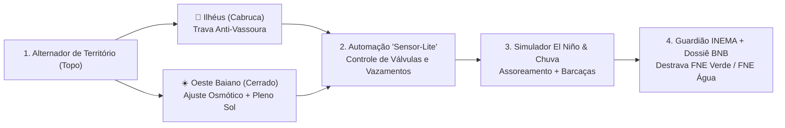

# Roteiro de Pitch, Defesa Técnica e Guia do Protótipo — AgroCiclo AI

> [!IMPORTANT]
> **Frase-Chave para Abrir ou Fechar o Pitch (Conectando direto com a palestra da FAEB):**
> *"Na Bahia, resiliência hídrica não tem uma única geografia — e a melhor tecnologia é aquela que cabe na propriedade, na outorga do INEMA e no bolso do produtor. O AgroCiclo AI transforma a água em ativo auditável para salvar o cacau da Cabruca em Ilhéus sem acordar a vassoura-de-bruxa, e para escalar o cacau a pleno sol no Oeste Baiano produzindo 10 vezes mais por hectare."*

---

## 1. Como Navegar e Demonstrar o Protótipo ao Vivo (Passo a Passo de 3 Minutos)

O protótipo já está rodando ao vivo em **`http://localhost:5173`** (e na rede local em **`http://192.168.15.6:5173`**) e também salvo como arquivo único portátil em [prototipo_standalone.html](file:///c:/teste%20hack/prototipo_standalone.html) (que você pode enviar no WhatsApp da equipe e abrir em qualquer computador sem instalar nada).

### Passo 1: Mostrar os Dois Territórios no Topo (`1. Visão Geral & Territórios`)
* Mostre para a banca o seletor no cabeçalho: **🌳 Sul da Bahia (Ilhéus • Cabruca)** vs. **☀️ Oeste Baiano (Cerrado • Pleno Sol)**.
* **O argumento científico que vocês vão falar:**
  * **Em Ilhéus (Cabruca):** O cacaueiro tem raízes superficiais acostumadas à chuva constante; nos veranicos do El Niño, 20 dias sem chuva derrubam as flores. Mas se o produtor irrigar por aspersão (molhando a copa), a umidade passa de 85% e explode a **Vassoura-de-Bruxa (*Moniliophthora perniciosa*)**. O nosso gotejamento sub-copa entrega água só na raiz (0–20 cm) e tem uma **Trava Fitossanitária Automática** que suspende a rega se a umidade do ar passar de 85%.
  * **No Oeste Baiano (Riachão das Neves / Barreiras):** Por que o cacau resiste ao clima seco do Cerrado e produz **3.000 kg/ha** (10x a média nacional)? Três fatores:
    1. **Escape Fitossanitário:** O ar seco (38% UR) e o sol pleno impedem a germinação dos fungos.
    2. **Ajuste Osmótico Ativo nas Raízes (*Moser et al., 2010*):** Sob ar seco e déficit controlado, o cacaueiro concentra solutos nas células da raiz para puxar água com mais eficiência e cria uma cabeleira radicular densa no bulbo molhado.
    3. **Delivery System (Fertirrigação por Gotejamento):** Entregando até **20 L/árvore/dia** (*CPCRI, 2010*) direto na raiz, a planta mantém os estômatos abertos debaixo do sol pleno do Cerrado, fazendo fotossíntese máxima sem desperdiçar água (gasta **224 mm** na seca contra **535 mm** da aspersão — *Jadin & Jacquemart, 1978*).

---

### Passo 2: Mostrar a Automação de Baixo Custo (`2. Automação de Gotejamento & Rede`)
> [!TIP]
> **Como responder aos "Erros que derrubam protótipos" (Slide 21 da FAEB):**
> Se a banca perguntar *"Mas pequeno produtor tem dinheiro para espalhar sensores no solo e tem internet na roça?"*, mostre os cards do topo da aba 2!

* **Arquitetura "Sensor-Lite" no Cabeçal (~R$ 680):** Zero sensores enterrados na roça para quebrar. Usamos apenas **1 controlador offline (LoRa/ESP32)** junto à bomba/reservatório com **1 hidrômetro de pulso + 1 sensor de pressão + válvulas solenoides**.
* **Diagnóstico Automático de Perdas Ocultas (Subtema 5):**
  * Aponte para o **Talhão 02** (em Ilhéus) ou **Setor C** (no Oeste): o sistema detectou sozinho que a **vazão caiu 19% e a pressão subiu para 2,35 bar**. Diagnóstico: **Gotejadores entupidos por ferro/calcário**! Clique no botão **"Executar Flushing (Desentupir)"** ao vivo para a banca ver a vazão voltar ao normal.
  * Clique também em **"Simular Mangueira Rompida"** em qualquer talhão: a vazão dispara (+32%), a pressão cai e o sistema **fecha a válvula solenoide automaticamente** para não esvaziar o açude!
* **Sincronia com a Tarifa Verde Noturna (Coelba):** Agendamento automático das 21h30 às 06h00 (-38% na conta de energia elétrica e zero evaporação de meio-dia).

---

### Passo 3: Simulador de Seca El Niño, Assoreamento e Chuva (`3. Simulador de Seca & Captação`)
* Alterne entre **15, 30, 60 e 90 dias sem chuva** e mexa nas caixas de seleção (*Cobertura Morta com Pseudocaule de Bananeira — Orchard & Saltos, 1988*, *Pulsos Noturnos*, *Ajuste Osmótico*).
* **Destaque o Alerta de Assoreamento Oculto (Subtema 2):** Mostre que na régua visual o produtor acha que tem **1.585 m³**, mas descontando o lodo no fundo do açude ele só tem **1.300 m³ reais**. Isso evita que ele seja pego de surpresa no meio da seca!
* **Captação nas Barcaças de Cacau:** Mostre a calculadora aproveitando os telhados das barcaças/estufas de secagem de cacau ($480\text{ m}^2$ em Ilhéus) e a **válvula de redistribuição automática** que desvia o excesso de chuvas torrenciais da cisterna para o açude sem perder uma gota.

---

### Passo 4: Segurança Jurídica (INEMA) e Crédito no Banco do Nordeste (`4. Outorga, Reúso & Crédito BNB`)
* Mostre o medidor da **Outorga / Dispensa de Outorga do INEMA** (Lei Federal 9.433/1997, Lei Estadual BA 11.612/2009 e Código Florestal 12.651/2012 com APP de nascentes preservada no CEFIR/CAR).
* **O Fechamento de Ouro para o Banco do Nordeste:** Clique no botão amarelo **"Gerar Dossiê de Conformidade INEMA & FNE Verde (BNB)"**. Ele abre na tela o laudo pronto para impressão com a **Economia em $\text{m}^3$** e a **Produtividade por $\text{m}^3$ ($\text{kg/m}^3$)** — exatamente a comprovação técnica que o produtor precisa para financiar o sistema de gotejamento no **FNE Água / FNE Verde** do Banco do Nordeste!

---

## 2. Checklist dos 5 Critérios da Banca (Slide 20 da FAEB)

| Critério da Banca (FAEB / BNB) | Como o nosso projeto responde na lata |
| :--- | :--- |
| **1. Aderência à realidade do produtor** | Funciona sem sensores de solo caros (arquitetura de cabeçal único), opera **100% offline** e usa resíduos da própria roça (pseudocaule de bananeira e casca de cacau) como cobertura morta. |
| **2. Custo total (implantação e manutenção)** | Elimina malha de sensores enterrados; detecta entupimento de gotejadores pela pressão da bomba e reduz em **38% a conta de energia** operando na Tarifa Verde noturna. |
| **3. Segurança jurídica** | Trava de bombeamento vinculada ao limite diário da **Outorga ou Dispensa de Outorga do INEMA** (Lei 11.612/09), respeito às APPs (Lei 12.651/12) e bloqueio sanitário contra reúso de efluentes sem tratamento. |
| **4. Resultado mensurável ($\text{m}^3$ e $\text{kg/m}^3$)** | Mede exatamente os $\text{m}^3$ poupados (-58% vs. aspersão: $224\text{ mm}$ vs. $535\text{ mm}$) e entrega o indicador de **$\text{kg de cacau por m}^3$** em tempo real. |
| **5. Escala territorial** | Atende desde o pequeno produtor familiar da **Cabruca em Ilhéus** (cooperativas) até os polos irrigados a **Pleno Sol no Oeste Baiano**, integrando o dossiê direto ao **Banco do Nordeste**. |
